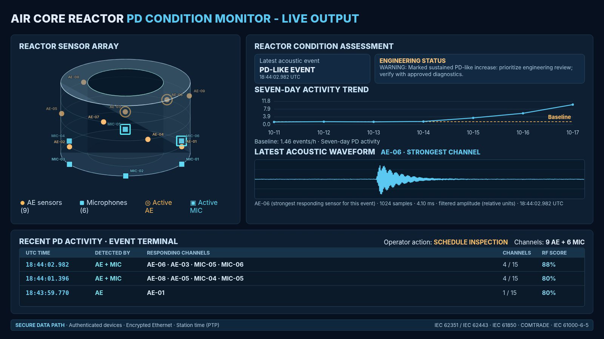

# Synthetic-Data Machine Learning for Air-Core Reactor PD-Like Acoustic Monitoring

**An experimental, dual-modality acoustic-monitoring prototype built around separate Random Forest classifiers for contact acoustic-emission (AE) and airborne-microphone signals.**

This project explores an ML workflow for distinguishing **PD-like acoustic events** from synthetic impact and vibration events in a dry-type air-core reactor. It combines modality-specific filtering and candidate detection, event-level feature extraction, Random Forest scoring, signal-quality diagnostics, evidence fusion, event logging, and an interactive operator dashboard. The waveforms, model-training examples, demo events, and historical trend are synthetic; this prototype does not establish field performance or diagnose electrical partial discharge.

The project was developed as a proof of concept for the **Trench × Hydro One Innovation Sprint — Track B**. It demonstrates an engineering monitoring workflow and a maintenance-oriented human–machine interface (HMI), **not** field-proven PD detection or compliance certification.



*Screenshot frame extracted at 00:03 from `docs/hmi-loop-1600x900.mp4`. The displayed activity is synthetic, and Random Forest scores and alert thresholds are illustrative and uncalibrated.*

## Machine-learning model

The learning component is a pair of **classical, modality-specific Random Forest classifiers**—one for AE and one for airborne microphones. The acoustic signal generator and reactor schematic are not learned models, and this prototype does not use a neural network.

| Model stage | Prototype implementation |
| --- | --- |
| Training examples | Per modality, each training run generates 180 PD-like, 180 impact, and 180 vibration waveforms. PD-like is the positive class; impact and vibration form the negative class. All are procedurally generated, not field recordings. |
| Candidate detection | Modality-specific band-pass filtering followed by envelope-based peak detection with a robust noise threshold. |
| Event features | RMS, crest factor, kurtosis, envelope rise and duration, spectral centroid, bandwidth and entropy, plus configured sub-band and multiscale energy summaries. |
| Classifier | Separate Random Forest per modality; 120 trees, minimum leaf size 4, and balanced class weights. |
| Decision and fusion | Signal-quality diagnostics gate decisions. The prototype uses uncalibrated score thresholds: at least 0.75 is PD-like, at most 0.25 is interference-like, and intermediate scores are uncertain. |

These scores are **not calibrated probabilities**. Optional sequence summaries (such as repetition rate and interval variability) are not inputs to the current event-level Random Forests. Independent field recordings, held-out validation, calibration, and verification across operating conditions remain future work.

## What the prototype does

The application models an acoustic monitoring chain from sensor signals to a condition assessment:

```text
Synthetic reactor acoustic sources
                │
       Acoustic sensor channels
        ┌───────┴────────┐
        │                │
    Contact AE       Airborne MIC
        │                │
  Filtering / candidate-event detection
        │                │
  Event-level acoustic feature extraction
        │                │
   AE Random Forest   MIC Random Forest
        └───────┬────────┘
                │
       Signal-quality diagnostics
                │
        Score fusion / uncertainty
                │
        Time-stamped SQLite events
                │
     Live HMI + seven-day PD-like trend
```

The two modalities have distinct nominal sampling rates and frequency bands. Each classifier is trained on **synthetically generated** PD-like and non-PD waveforms; neither is pretrained or validated on a field dataset. Conventional diagnostics provide additional signal-quality evidence. A missing microphone detection is not, by itself, proof that a contact-AE detection is invalid.

## Sensor layout and visualization

The presentation HMI uses **15 synthetic acoustic channels** on a short hollow cylindrical reactor:

| Sensor type | Proposed position | Channels |
| --- | --- | ---: |
| Surface-mounted AE | Outer winding at 0.25H: 0°, 120°, 240° | 3 |
| Surface-mounted AE | Outer winding at 0.50H: 40°, 160°, 280° | 3 |
| Surface-mounted AE | Outer winding at 0.75H: 80°, 200°, 320° | 3 |
| Airborne microphones | Beneath bottom rim: 0°, 60°, 120°, 180°, 240°, 300° | 6 |
| **Total** | | **15** |

The 40° offset between AE levels staggers the sensing locations. Circular markers denote surface AE sensors and square markers denote microphones. The 3D schematic is deliberately simplified: a hollow cylinder without supports, auxiliaries, or winding details. Bottom microphones are depicted with a small air gap to indicate non-contact sensing; the proposed physical installation is beneath the spider arms. Drag horizontally to rotate the schematic.

**Presentation design:** fixed 1920 × 1080 canvas, large headings and values, only three latest PD-like events, a prominent operator action, and a seven-day trend and waveform. All events remain stored in SQLite even though the HMI displays only the latest three. Synthetic marker intensities are not validated source localization.

Physical installation, dielectric mounting, temperature and field limits, clearances, and routing require asset-owner approval. The schematic is not a fabrication drawing.

## Quick start

Requires **Python 3.10+** and a modern desktop browser.

```bash
# Clone the repository
 git clone https://github.com/jimmyxgan/innovation_sprint.git
 cd innovation_sprint

# Optional: create a virtual environment
 python -m venv .venv
 # Windows PowerShell: .venv\Scripts\Activate.ps1
 # macOS/Linux: source .venv/bin/activate

 pip install -r requirements.txt
 python app.py --demo --reset-demo-db --port 8765
```

Open **http://localhost:8765/**.

> **Data warning:** `--reset-demo-db` deletes the local `monitor_v3.sqlite3` database. Use it for a fresh presentation, but omit it when you want to preserve previous runs.

The `--demo` mode seeds an explicitly scripted seven-day baseline and generates synthetic acoustic events on a roughly three-second cadence (plus processing time). The dashboard polls for updated condition and event data. This is **accelerated demonstration activity**, not a calibrated real-world PD occurrence rate.

Other useful commands:

```bash
python app.py --demo --port 8765              # Continue with existing local database
python app.py --port 8765                     # Run without the scripted demo mode
python app.py --demo --period 5 --port 8765   # Change acquisition interval
python app.py --demo --seed-only              # Seed the demo baseline and exit
python app.py --legacy --port 8765            # Use the older AE-only pipeline
python test_integration.py
python test_trends.py
python validate.py
```

## Reading the HMI

The **left panel** shows the 3D isometric sensor layout and the channels responding to the most recent PD-like event. The **center panel** reports the latest condition assessment, the number of responding sensors, the seven-day PD-like event trend, an illustrative baseline comparison, and the waveform from the strongest responding sensor. The **right panel** focuses on actionable PD-like events; non-PD and uncertain candidates are still retained in the database for analysis rather than dominating the operator log.

The seven-day trend combines **scripted historical demo totals** with current simulated detector activity. Its hourly normalization and alert thresholds are illustrative. It must not be interpreted as seven days of independently acquired field measurements or as an IEC-defined alarm limit.

The HMI intentionally omits UV channels: this demonstration uses AE and airborne acoustic sensing only.

## Repository structure

| File | Role |
| --- | --- |
| `app.py` | HTTP server, demo acquisition loop, SQLite event storage, API endpoints and status aggregation |
| `dashboard.html` | Interactive isometric HMI, trend chart, waveform and operator event list |
| `integrated_pipeline.py` | Dual-modality channel simulation, classification workflow and event association |
| `sensors.py` | AE and microphone sampling and frequency-band configuration |
| `signal_processing.py` | Modality-specific preprocessing and candidate detection |
| `features.py` | Event-level acoustic features and optional sequence summaries |
| `ml_classifier.py` | Random Forest training and inference |
| `conventional.py` | Conventional signal-quality checks |
| `fusion.py` | Combination of classifier and diagnostic evidence |
| `physics.py`, `processing.py` | Original synthetic acoustic model and legacy AE-only processing |
| `outbox_demo.py` | Demonstration of a local event-delivery outbox |
| `test_*.py`, `validate.py` | Regression, integration and validation checks |
| `STANDARDS_MATRIX.md` | Proposed standards mapping and unresolved implementation work |
| `ML_COMPLIANCE.md` | ML evaluation and risk-management verification checklist |
| `docs/hmi-dashboard.png` | README screenshot extracted from the HMI demo video |

## Data and validation boundaries

**Implemented in this repository:** synthetic AE/microphone waveforms, preprocessing, RF-based PD-like classification, signal-quality checks, basic evidence fusion, event-level time stamps, local SQLite persistence, a seven-day illustrative trend, and an interactive HMI.

**Not implemented or not established:** calibrated acoustic transfer functions for a specific reactor, field-trained or independently validated classifiers, verified PD source localization, sensitivity in apparent charge (pC), approved physical mounting and routing, hardware-grade synchronized timestamps, operational cybersecurity, IEC 61850 station integration, COMTRADE export, or production monitoring uptime accounting.

In particular, **PD-like** is a classifier output, not a definitive electrical PD diagnosis. The HMI is intended to support review and inspection decisions, not autonomous protection or tripping.

For the intended engineering qualification pathway, see [`STANDARDS_MATRIX.md`](STANDARDS_MATRIX.md) and [`ML_COMPLIANCE.md`](ML_COMPLIANCE.md). The references include **IEC TS 62478** for non-conventional PD measurements, **ISO/IEC TS 4213** for classification performance assessment, and **ISO/IEC 23894** for AI risk management. These are design and verification references, **not claims of certification**.

## Project status

**Research and presentation prototype — synthetic demonstration only.** The next technical milestones are physically credible propagation/transfer models, approved sensor placement, independent PD/non-PD experimental recordings, held-out validation, calibration, and secure integration into an operational monitoring system.

## Presentation capture

The screenshot above is a frame from the included `docs/hmi-loop-1600x900.mp4` recording. To capture a fresh HMI state, run `python app.py --demo --reset-demo-db --port 8765`, open `http://localhost:8765/`, and capture the full dashboard at 1920 × 1080. The HMI is letterboxed to preserve 16:9 when the browser aspect ratio differs. Use the browser's fullscreen mode for the cleanest slide capture.

**Important:** Always use `--reset-demo-db` when switching from the earlier 96-channel project; historical event arrays use a different geometry. This deletes the local demo database.


## Presentation layout (v3)

- Fixed 1920 × 1080 dashboard with a full-width four-line event terminal.
- Nine surface AE sensors and six bottom-rim microphones. Active AE channels use amber circular halos; active microphone channels use cyan square outlines.
- Demo source cadence defaults to 1.5 seconds (change with `--period`).
- Security ribbon identifies **proposed design targets only**, not implemented/certified cybersecurity or IEC interoperability. The prototype serves HTTP locally, and demo timestamps are software-clock timestamps.
- IEC 62351, IEC 62443, IEC 61850, IEC/IEEE 61850-9-3, IEC 60255-24 (COMTRADE), IEC 61000-6-5 and IEC 60068 are relevant planned engineering references, subject to validation.
- Physical sensor placement, high-voltage insulation, magnetic-field immunity, thermal survival, calibration, EMC, and station integration require engineering verification.


## Slide-ready dashboard (v4)

The 1920 × 1080 dashboard uses a larger reactor schematic, 9 AE + 6 microphone
markers, a compact condition headline and engineering-status panel, and a
terminal-style event log listing **UTC time, modality, individual responding
channel IDs, channel count and synthetic classifier score**. The latest three
PD-like events are shown; the database retains the full history.

For presentation clarity, the synthetic signal generator excites no more than
four geometrically nearby channels per injected event (including both modalities).
This is an illustrative locality constraint, not a validated acoustic propagation
model or a physical detection limit. Other noise candidates may be processed
independently.

The footer names relevant secure-data-path standards as an architectural
reference. Authentication, encryption, station PTP, IEC 61850, COMTRADE and
EMC compliance are **not implemented or certified by this demonstration**.

## Slide layout and signal-display notes

The dashboard is designed on a fixed 1920 × 1080 canvas. The reactor diagram shows nine outer-surface AE sensors and six microphones positioned below the lower outer rim. The most recent PD-like capture is displayed using its **unfiltered synthetic acquisition window**, including the continuously present background noise. Detection and classification continue to use the filtered waveform internally; the plot is not a separate idealized pulse.

The event terminal shows UTC time to milliseconds, sensor IDs, modality, responding-channel count and Random Forest score. Multiple events may occur within the same second; milliseconds distinguish their timestamps. The seven-day historical trend and the sensor signals are synthetic. Security standards listed in the footer describe the intended station readout architecture, not an implemented authenticated or IEC-certified station connection.

### Presentation layout updates (v6)

- Waveform visualization uses the filtered acoustic event capture with display-only soft-threshold noise reduction. A low-level background noise floor remains visible. Detection and RF scoring still use the original processed signals.
- All six airborne microphones are positioned on the outside bottom rim of the schematic, spaced 60° apart. The nine outer-surface AE sensors remain in three staggered height rings.
- The recent activity terminal shows three complete event rows, with millisecond-resolution UTC timestamps, responding sensor IDs, channel count and RF score.

### Presentation waveform and layout

The event waveform uses a consistent, low-amplitude filtered-noise floor with
an overlaid, smoothly enveloped transient. This visualization does not change
the detector inputs, RF classification, or saved event statistics. The 16:9
layout reserves room for the complete waveform caption and moves the reactor
schematic upward while preserving all fifteen sensor markers.


### Presentation adjustments (v8)
The waveform display aligns the transient peak at approximately 38% of the capture window, retaining a continuous low-amplitude baseline. This affects visualization only, not classification or acquisition timestamps. The rotatable reactor schematic labels every AE-01–AE-09 and MIC-01–MIC-06 node using leader lines.


## PowerPoint presentation video

A 10-second, 1920 × 1080 H.264 MP4 is included in `docs/hmi_loop_10s.mp4`. It was captured from the dashboard using recorded synthetic event data. In PowerPoint, insert the MP4 via **Insert → Video → This Device** and enable **Loop until Stopped** and **Start Automatically** in the Playback ribbon. The recording is a representative visualization, not a live stream.

The reactor schematic uses compact labels adjacent to the 9 AE and 6 microphone markers. The seven-day activity plot uses enlarged axis labels and baseline annotation for slide readability.


### PowerPoint video

The accompanying 10-second H.264 MP4 is 1600 × 900 (16:9). Set **Playback → Loop until Stopped** in PowerPoint. The event terminal displays UTC time with millisecond precision (`HH:mm:ss.SSS`); stored records retain the full date and timezone.
